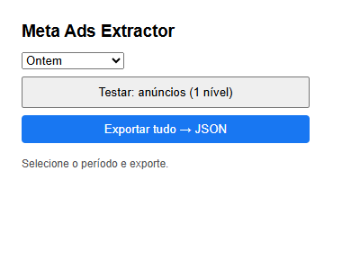
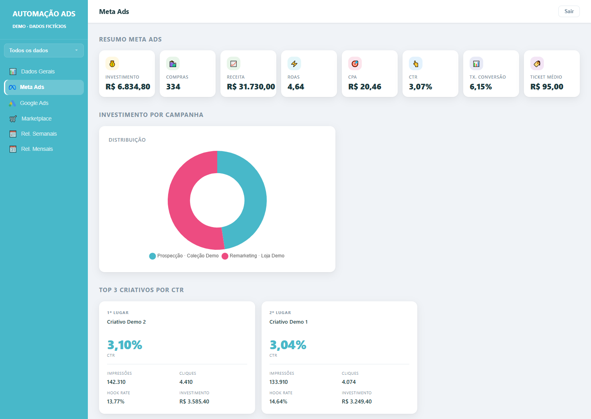
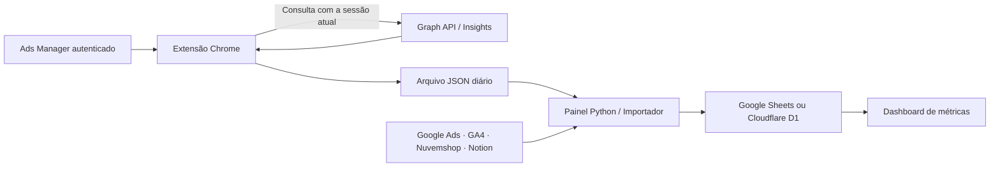

# Meta Ads Extractor + Painel de Dados

**Da sessão do Ads Manager ao dashboard: uma automação para coletar, organizar e analisar métricas de tráfego pago.**

Uma extensão Chrome exporta campanhas, conjuntos e anúncios em JSON, com dados por dia. Um painel Python coordena a importação e as demais fontes de marketing; os dados podem ser gravados no Google Sheets ou no Cloudflare D1 e consultados em um dashboard web.

O projeto nasceu de uma necessidade real: manter a rotina de análise quando a configuração de uma integração própria com a API da Meta estava indisponível. A coleta parte da sessão autenticada no Ads Manager, sem exigir que o usuário configure um app próprio e copie um token manualmente.

> **Precisão técnica:** a extensão faz consultas à Graph API usando o token temporário da sessão. Ela dispensa uma integração própria com a Marketing API, mas depende da API e das permissões da conta. Não desbloqueia contas nem garante acesso quando a Meta recusa a consulta.





## O que a automação entrega

- **Extensão Manifest V3:** coleta em três níveis, períodos de hoje/ontem/7/30 dias e paginação com granularidade diária.
- **JSON estruturado:** impressões, alcance, cliques no link, investimento, leads, visualizações e identificadores, conforme o nível.
- **Painel desktop:** seleção do arquivo, importação e acompanhamento da execução em log, sem bloquear a interface.
- **Pipeline de métricas:** integração com Sheets ou D1, cálculo de indicadores e organização de campanhas, conjuntos e anúncios.
- **Fontes complementares:** Google Ads, GA4, Nuvemshop e CRM do Notion, quando configuradas.
- **Dashboard web:** indicadores, filtros por período e relatórios. A demonstração usa o frontend existente com uma fonte local de dados fictícios.



## Veja a demonstração em 1 minuto

Requer Python 3.11 ou superior. A demo usa apenas a biblioteca padrão:

```bash
python demo.py
```

Abra **http://127.0.0.1:8765**. A demonstração não lê `.env`, não acessa contas de anúncios e não grava em bancos. Os gráficos carregam Chart.js pelo CDN; é necessária conexão para eles. Os dados são simulados de 1 a 28 de outubro de 2026: use “Todos os dados” ou esse intervalo.

Um [JSON de exemplo](examples/meta-demo.json) permite inspecionar o contrato de exportação. O [roteiro de apresentação](docs/DEMONSTRACAO.md) ajuda a explicar o projeto em poucos minutos.

## Instale a extensão

1. Baixe ou clone este repositório.
2. Abra `chrome://extensions` e ative o **Modo do desenvolvedor**.
3. Clique em **Carregar sem compactação** e selecione `extensao-meta-ads`.
4. Abra o Ads Manager em uma conta à qual você tenha acesso e aguarde carregar.
5. Abra a extensão, selecione o período e clique em **Exportar tudo → JSON**.

O arquivo será salvo em Downloads com nome `meta_<conta>_<data>_<periodo>.json`. Mantenha o popup aberto até concluir. Não é necessário instalar Python para usar somente a extensão.

Veja os [detalhes da extensão e das permissões](extensao-meta-ads/README.md).

## Execute o painel e as integrações

Esta publicação contém uma cópia selecionada do código operacional. IDs de contas foram substituídos por exemplos; credenciais, mapas de IDs e dados reais foram excluídos. Os nomes internos `lucri` e `cwbkids` identificam os dois perfis originais de processamento.

```bash
python -m venv .venv
# Windows PowerShell:
.venv\Scripts\Activate.ps1
python -m pip install -r requirements-metricas.txt
```

Copie `.env.example` para `.env` e configure as integrações que deseja usar. Antes de importar dados reais:

1. Ajuste `CLIENTES` em `scripts/meta_from_extension.py` para suas contas e variáveis de destino.
2. Configure a service account do Google e as planilhas com os cabeçalhos esperados. O adaptador atual também inicializa esse cliente quando D1 está ativo.
3. Para D1, configure `METRICAS_BACKEND=d1`, IDs dos bancos e autenticação Cloudflare; os esquemas estão em `cloudflare/`. Esta publicação não cria nem migra bancos automaticamente.
4. Execute `python painel.py` ou informe o arquivo diretamente:

```bash
python scripts/meta_from_extension.py examples/meta-demo.json
```

**O importador operacional grava no destino configurado.** Para conhecer o projeto sem configurar integrações, use `python demo.py`. O JSON de exemplo é fictício, mas não transforma a importação em uma simulação.

O painel Tkinter foi pensado para Windows. O frontend web inclui referências de execução em Cloudflare Pages e Vercel; publicar um ambiente real exige configurar autenticação e variáveis. Não há deploy automático neste repositório.

## Validação

Requer Node.js 22+ e as dependências Python para a suíte completa:

```bash
node --test tests/test_extension.mjs
python -m unittest discover -s tests -p "test_*.py"
node tests/test_dashboard_d1.mjs
```

Os testes usam respostas simuladas e SQLite em memória. Cobrem paginação, mudança de conta, falhas de conexão, exportação sem token no JSON, importação, idempotência no D1, preservação de campos do CRM, datas, percentuais e autenticação do endpoint do dashboard de loja. Não substituem uma validação com a sessão real no Chrome.

## Limites e evolução

O reconhecimento da sessão depende de recursos carregados pelo Ads Manager; alterações da Meta podem exigir manutenção. O token pode expirar e as consultas podem ser recusadas. O processo exige abrir o navegador e acionar a exportação. Métricas “Hoje” podem estar parciais.

A [revisão técnica](docs/REVISAO.md) registra os ajustes pequenos feitos nesta versão e os próximos passos que precisam de uma revisão maior, sem alterar as regras de negócio em uso.

**Stack:** JavaScript · Chrome Extensions MV3 · Python · Tkinter · Google Sheets · Cloudflare D1 · SQLite · Chart.js.
